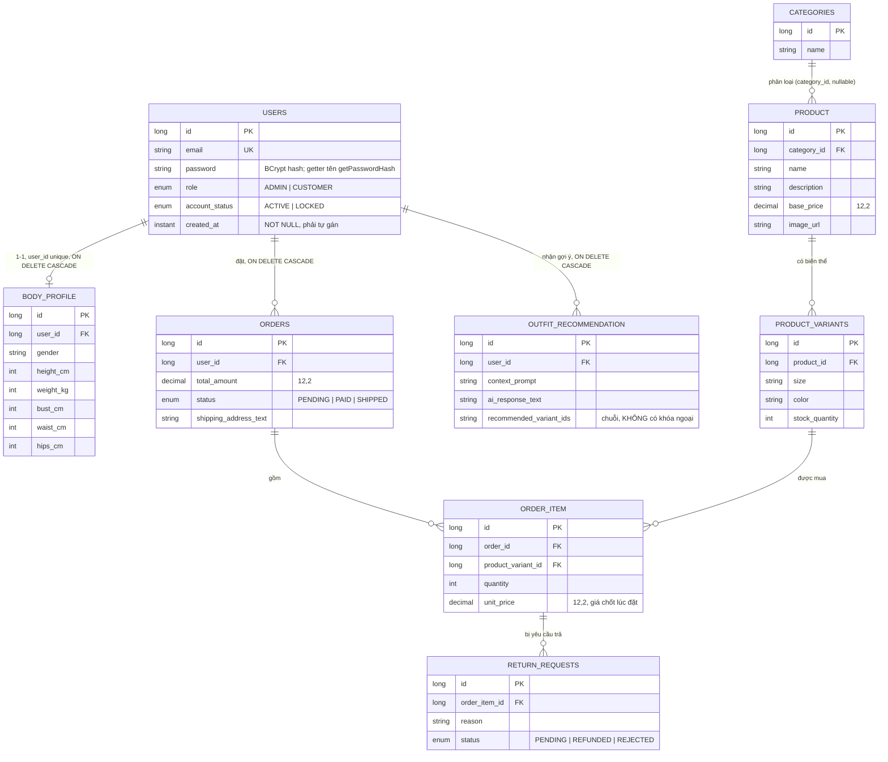

# CODEBASE – Hướng dẫn cho lập trình viên mới và AI Agent (WELO)

> Đọc file này trước khi sửa code. Tài liệu liên quan:
> - [`rule.md`](rule.md): **yêu cầu bắt buộc của đề tài** (mọi thứ khác phải đáp ứng file này).
> - [`proposal.md`](proposal.md): mục tiêu, kiến trúc, lộ trình, phân công (v0.3).
> - [`docs/mvp-daily-plan.md`](docs/mvp-daily-plan.md): task từng ngày, từng người trong 2 tuần đầu, và danh sách kiểm tra cổng MVP.
> - [`docs/api/openapi.yaml`](docs/api/openapi.yaml): hợp đồng API giữa frontend và backend (xem bằng Swagger Editor hoặc IDE).
> - [`docs/data-ownership.md`](docs/data-ownership.md): bảng nào do ai sở hữu, ai được ghi, các tệp dùng chung.
> - [`docs/ai-spec.md`](docs/ai-spec.md): đặc tả AI gợi ý trang phục (luồng, prompt, kiểm chứng đầu ra, chi phí).
> - [`docs/backlog.md`](docs/backlog.md): task theo Dev và giai đoạn, tiêu chí nghiệm thu, đường găng, phân tích khối lượng.
>
> **Quy ước đọc:** mục nào ghi **[Hiện có]** là đúng với code ở thời điểm viết (15/11/2026). Mục ghi **[Mục tiêu]** là thiết kế đã chốt nhưng **chưa có trong code**. Đừng giả định một thứ tồn tại chỉ vì nó nằm trong tài liệu này; hãy kiểm tra code.

---

## 1. Tổng quan cấu trúc repo

WELO là website bán hàng của **một shop thời trang duy nhất**, có tính năng gợi ý trang phục bằng AI dựa trên số đo cơ thể và ngữ cảnh. Git repo nằm ở thư mục `webDevProject/` (nhánh chính `main`).

### 1.1. Sơ đồ thư mục [Hiện có]

```
webDevProject/
├── proposal.md                      Proposal: mục tiêu, kiến trúc, lộ trình
├── codebase.md                      File này
├── backend/
│   └── webApplication/              Ứng dụng Spring Boot (Java 21, Maven)
│       ├── pom.xml
│       ├── mvnw, mvnw.cmd           Maven Wrapper (không cần cài Maven)
│       ├── compose.yaml             MySQL cho môi trường dev (Docker)
│       └── src/
│           ├── main/java/com/example/webApplication/
│           │   ├── WebApplication.java      Điểm vào (@SpringBootApplication)
│           │   ├── Entity/                  Thực thể JPA + enum trạng thái
│           │   ├── Dto/                     DTO dạng `record`
│           │   ├── Repository/              Spring Data JPA (CategoryRepo, OrderRepo, ProductRepo, UserRepo)
│           │   └── Service/                 Hiện chỉ có UserService (còn rỗng)
│           ├── main/resources/application.properties
│           └── test/java/.../WebApplicationTests.java
└── frontEnd/                        Giao diện tĩnh, tên cũ "UNIKURO"
    ├── UNIKURO-Storefront-v2.html
    ├── UNIKURO-storefront-v2.css
    ├── cart-variant.svg
    └── images/
```

### 1.2. Công nghệ

| Lớp | Hiện có | Mục tiêu (theo `proposal.md`) |
|---|---|---|
| Backend | Spring Boot **4.1.1**, Java **21**, Spring Data JPA, Spring Security, Spring WebMVC, MySQL Connector/J, `spring-boot-docker-compose` | + Flyway, Redis, JWT, springdoc-openapi, Testcontainers |
| Cơ sở dữ liệu | MySQL (`ddl-auto=update`) | MySQL 8 trên Cloud SQL, migration bằng Flyway, `ddl-auto=validate` |
| Frontend | HTML/CSS tĩnh | React + TypeScript + Vite + Tailwind (PWA) |
| Hạ tầng | Chưa có | Docker, GitHub Actions, Google Cloud Run |

### 1.3. Hiện trạng theo module

| Module | Entity | DTO | Repository | Service | Controller |
|---|:--:|:--:|:--:|:--:|:--:|
| User / Auth | ✔ | ✔ | ✔ | khung rỗng | ✘ |
| BodyProfile | ✔ | ✔ | ✘ | ✘ | ✘ |
| OutfitRecommendation (AI) | ✔ | ✔ | ✘ | ✘ | ✘ |
| Category | ✔ | ✔ | ✔ | ✘ | ✘ |
| Product, ProductVariant | ✔ | ✔ | Product ✔, Variant ✘ | ✘ | ✘ |
| Order, OrderItem | ✔ | ✔ | Order ✔, OrderItem ✘ | ✘ | ✘ |
| ReturnOrder | ✔ | ✔ | ✘ | ✘ | ✘ |
| Cart, Voucher, Payment, Address, Review, Notification | ✘ | ✘ | ✘ | ✘ | ✘ |

**Chưa có:** controller nào, cấu hình bảo mật (`SecurityConfig`), mapper Entity↔DTO, code gọi LLM, Dockerfile, CI/CD, migration Flyway, Redis.

### 1.4. Quy ước đặt code

- Package cha: `com.example.webApplication`. Các package con đang viết **hoa chữ đầu** (`Entity`, `Dto`, `Repository`, `Service`); giữ nguyên, thêm `Controller`, `Config`, `Mapper` theo cùng kiểu.
- Entity: getter/setter viết tay, khóa chính `long id` với `GenerationType.IDENTITY`.
- DTO: `record` bất biến, **không bao giờ** chứa mật khẩu hoặc thông tin nội bộ.
- Repository: interface kế thừa `JpaRepository<Entity, Long>`, tên kết thúc bằng `Repo`.
- Giao diện ↔ backend đi qua **DTO**, không trả Entity ra API.
- Mỗi module (identity, catalog, order, inventory, payment, outfit-ai…) có một người chịu trách nhiệm; xem phân công ở `proposal.md` mục 9.2.

---

## 2. Cài đặt và lệnh chạy hằng ngày

### 2.1. Yêu cầu

| Công cụ | Ghi chú |
|---|---|
| **JDK 21 trở lên** | Dự án khai báo `java.version=21`. Kiểm tra bằng `java -version` |
| Maven | **Không cần cài**; dùng `mvnw`/`mvnw.cmd`. Lần chạy đầu sẽ tải Maven 3.9.16 |
| **MySQL 8** *hoặc* **Docker Desktop** | Một trong hai (xem 2.3) |
| Git | Repo nằm ở `webDevProject/`, chạy lệnh git từ thư mục này |
| Node.js | Chỉ cần khi có frontend Vite **[Mục tiêu]**; frontend tĩnh hiện tại không cần |

### 2.2. Lấy code

```bash
git clone https://github.com/Zerzo15/webDevProject.git
cd webDevProject
git checkout -b feature/<ten-module>-<mo-ta-ngan>
```

### 2.3. Chuẩn bị cơ sở dữ liệu

Hai cách. **Chọn một**, và đọc kỹ cảnh báo cuối mục.

**Cách A – MySQL cài sẵn (khớp `application.properties`)**

Tạo DB `web_db`. Cấu hình mặc định trong repo: user `root`, mật khẩu đã commit trong `application.properties` (xem "Điểm dễ sai" số 14). Khuyến nghị **ghi đè bằng biến môi trường** thay vì sửa file:

```powershell
# PowerShell
$env:SPRING_DATASOURCE_URL      = "jdbc:mysql://localhost:3306/web_db"
$env:SPRING_DATASOURCE_USERNAME = "root"
$env:SPRING_DATASOURCE_PASSWORD = "<mat-khau-cua-ban>"
```

```bash
# bash
export SPRING_DATASOURCE_URL=jdbc:mysql://localhost:3306/web_db
export SPRING_DATASOURCE_USERNAME=root
export SPRING_DATASOURCE_PASSWORD='<mat-khau-cua-ban>'
```

Khi dùng cách A, **tắt** tích hợp Docker Compose (xem cảnh báo bên dưới): `SPRING_DOCKER_COMPOSE_ENABLED=false`.

**Cách B – Docker (`compose.yaml`)**

`compose.yaml` chạy MySQL với DB `mydatabase`, user `myuser`, mật khẩu `secret`, cổng 3306 trong container (cổng máy chủ do Docker chọn ngẫu nhiên). Vì `pom.xml` có `spring-boot-docker-compose`, khi chạy ứng dụng, Spring Boot **tự khởi động compose và tự cấu hình datasource** theo container, bỏ qua `spring.datasource.*`.

**Cảnh báo (nguồn lỗi hay gặp):**
- Cấu hình hai nơi **đang lệch nhau** (`web_db`/`root` ở properties, `mydatabase`/`myuser` ở compose). Cái nào chạy tùy việc Docker có sẵn không.
- Máy **không có Docker** mà không tắt tính năng này thì ứng dụng báo lỗi khi khởi động. Đặt `SPRING_DOCKER_COMPOSE_ENABLED=false` rồi dùng cách A.
- Việc thống nhất hai cấu hình là nhiệm vụ GĐ0 (xem `proposal.md` mục 9.3).

### 2.4. Lệnh hằng ngày

Chạy từ `backend/webApplication/`. Trên Windows dùng `.\mvnw.cmd`; trên macOS/Linux/Git Bash dùng `./mvnw`.

| Việc | PowerShell | bash |
|---|---|---|
| Chạy ứng dụng (cổng mặc định 8080) | `.\mvnw.cmd spring-boot:run` | `./mvnw spring-boot:run` |
| Biên dịch nhanh | `.\mvnw.cmd -q -DskipTests compile` | `./mvnw -q -DskipTests compile` |
| Chạy test | `.\mvnw.cmd test` | `./mvnw test` |
| Đóng gói JAR | `.\mvnw.cmd clean package` | `./mvnw clean package` |
| Chạy JAR đã đóng gói | `java -jar target\webApplication-0.0.1-SNAPSHOT.jar` | `java -jar target/webApplication-0.0.1-SNAPSHOT.jar` |
| Xóa build | `.\mvnw.cmd clean` | `./mvnw clean` |

Lưu ý khi chạy:
- Test duy nhất hiện nay là `WebApplicationTests.contextLoads` (`@SpringBootTest`). Nó **cần DB kết nối được**; không có DB thì test lỗi. Dùng Testcontainers là việc ở GĐ0.
- `spring.jpa.show-sql=true` in toàn bộ SQL ra console; tắt khi cần đọc log.
- Vì đã có Spring Security, **mọi endpoint sẽ trả 401** cho tới khi có `SecurityConfig` (xem điểm dễ sai số 12).

**Frontend hiện tại [Hiện có]:** mở trực tiếp `frontEnd/UNIKURO-Storefront-v2.html` bằng trình duyệt. Chưa có bước build.

**Frontend Vite [Mục tiêu]** (chỉ áp dụng sau khi thư mục frontend được dựng ở GĐ0): `npm install`, `npm run dev`, `npm run build`.

### 2.5. Quy trình làm việc với git

1. Tạo nhánh từ `main`: `feature/<module>-<mo-ta>`.
2. Commit nhỏ, thông điệp rõ ràng.
3. Mở pull request vào `main`, cần ít nhất một người review; CI (khi có) phải xanh.
4. Không commit secret (mật khẩu DB, khóa API, token), không commit `target/`.

---

## 3. Sơ đồ quan hệ dữ liệu dùng chung

### 3.1. Sơ đồ hiện có (đọc từ Entity)



Tên bảng: các entity có `@Table` dùng tên đó (`users`, `categories`, `orders`, `product_variants`, `return_requests`). Entity còn lại dùng quy tắc đặt tên mặc định của Spring Boot (camelCase → snake_case): `body_profile`, `product`, `order_item`, `outfit_recommendation`.

### 3.2. Quy tắc dùng chung khi đụng vào dữ liệu

- **Chủ sở hữu bản ghi:** `BodyProfile`, `Order`, `OutfitRecommendation` luôn gắn với `user_id`. Lọc theo người dùng lấy từ token, không lấy từ request.
- **Giá lịch sử:** `OrderItem.unit_price` là giá **chốt tại thời điểm đặt**. Không bao giờ tính lại từ `Product.base_price` cho đơn đã tạo.
- **Tồn kho** ở mức **biến thể** (`ProductVariant.stock_quantity`), không ở mức sản phẩm.
- **Xóa:** `ON DELETE CASCADE` ở `BodyProfile`, `Order`, `OutfitRecommendation` nghĩa là xóa user sẽ xóa luôn đơn hàng. Dùng `AccountStatus.LOCKED` thay vì xóa cứng user.
- **Tham chiếu mềm:** `recommended_variant_ids` là chuỗi chứa id biến thể; cơ sở dữ liệu không kiểm tra. Luôn kiểm chứng id còn tồn tại trước khi dùng.

### 3.3. Bảng/trường sẽ thêm [Mục tiêu]

Danh sách đầy đủ ở `proposal.md` mục 8: `refresh_tokens`, `otp_codes`, `addresses`, `carts`/`cart_items`, `stock_reservations`, `payments`, `vouchers`/`voucher_usages`, `order_status_history`, `reviews`, `notifications`/`outbox_events`, `user_events`, cùng các cột mới (`reservedQuantity`, `version` ở biến thể; dáng người và màu da ở `BodyProfile`; phương thức thanh toán, phí ship, mã vận đơn ở `Order`).

Mọi thay đổi schema về sau đi qua **Flyway**, không dựa vào `ddl-auto=update`.

---

## 4. Quy tắc nghiệp vụ cốt lõi đã chốt

> **Đọc phần này trước khi viết bất kỳ logic đơn hàng, kho, thanh toán, hoàn tiền nào.**
>
> Các quy tắc gốc viết cho sàn đa người bán. WELO là **một shop duy nhất** nên đã chuyển như sau: "Người bán" = **Admin (nhân sự shop)**; không có Mall, hoa hồng, escrow; thanh toán online chỉ có **VietQR** (và COD). Giá trị tham số đã chốt: **N = 7 ngày**, giữ chỗ VietQR **30 phút**, **X = 7 ngày**. Cả ba cấu hình được, không viết cứng trong code.

### 4.1. Vòng đời đơn hàng (Order State Machine)

Mọi đơn hàng tuân theo một **máy trạng thái hữu hạn (FSM)** chặt chẽ. **Không nhảy cóc, không đi ngược.**

**Luồng chuẩn:**

`Chờ thanh toán` → `Chờ xác nhận` → `Chờ lấy hàng` → `Đang giao hàng` → `Đã giao hàng` → `Hoàn tất`

- Đơn **COD** được tạo thẳng ở `Chờ xác nhận` (không có bước `Chờ thanh toán`). Chỉ đơn **VietQR** đi qua `Chờ thanh toán`.

**Quy tắc hủy đơn:**

| Trạng thái đơn | Người mua hủy | Ai quyết định |
|---|---|---|
| Chờ thanh toán | Được hủy **tự do** | Không cần duyệt |
| Chờ xác nhận | Được hủy **tự do** | Không cần duyệt |
| Chờ lấy hàng (shop đã in vận đơn/đóng gói) | Chỉ **gửi yêu cầu hủy** | **Admin phải đồng ý** |
| Đang giao hàng (shipper đã lấy hàng) | **Không thể hủy** | Chỉ có thể từ chối nhận hàng hoặc làm thủ tục Trả hàng/Hoàn tiền |

**Tự động hoàn tất:** đơn ở `Đã giao hàng` quá **N ngày** mà người mua không bấm "Đã nhận được hàng" và không phát sinh khiếu nại, hệ thống tự chuyển sang `Hoàn tất`. (Nguyên văn gốc: "để giải ngân cho người bán". WELO không có giải ngân trung gian, nên bước này chốt doanh thu và khóa quyền đổi trả theo thời hạn.)

**Trạng thái mục tiêu của `OrderStatus` [Mục tiêu, chưa có trong code]:**

| Tên hiển thị | Giá trị enum đề xuất | Ghi chú |
|---|---|---|
| Chờ thanh toán | `PENDING_PAYMENT` | Chỉ VietQR |
| Chờ xác nhận | `PENDING_CONFIRMATION` | COD bắt đầu ở đây |
| Chờ lấy hàng | `AWAITING_PICKUP` | |
| Đang giao hàng | `SHIPPING` | |
| Đã giao hàng | `DELIVERED` | |
| Hoàn tất | `COMPLETED` | Trạng thái cuối |
| Đã hủy | `CANCELLED` | Trạng thái cuối |

Enum hiện tại là `PENDING, PAID, SHIPPED` và **không khớp** FSM; không tự suy diễn ánh xạ, hãy mở rộng enum có chủ đích (kèm migration).

**Cách cài đặt đúng:**
- Chỉ **một nơi** được đổi trạng thái đơn (ví dụ `OrderStateMachine`/`OrderService.transition(...)`), có bảng chuyển hợp lệ. Controller và job **không** gọi `setStatus` trực tiếp.
- Mỗi lần chuyển ghi `order_status_history` (ai, lúc nào, lý do).
- Chuyển trạng thái phải **idempotent** và chạy trong giao dịch, có kiểm tra trạng thái hiện tại trước khi chuyển.

### 4.2. Quản lý tồn kho (Inventory & Reservation)

Mục tiêu: không bán lố (Overselling) khi nhiều người cùng mua sản phẩm cuối cùng, đồng thời không để khách "ôm hàng" ảo làm giam tồn kho.

**Thời điểm trừ/giữ tồn kho (Stock Reservation):**

| Phương thức | Hành động |
|---|---|
| **COD** | **Trừ tồn khả dụng** (Available Stock) ngay khi người mua bấm "Đặt hàng" thành công |
| **Online (VietQR)** | **Tạm khóa** tồn kho (Reserved Stock) trong **30 phút**. Quá hạn chưa thanh toán thành công: hệ thống **tự hủy đơn** và **hoàn trả** tồn kho (Release Stock) |

**Hoàn tồn kho khi hủy/trả:** tồn kho **chỉ** được cộng lại khi:
1. đơn chuyển sang `Đã hủy` **trước khi xuất kho**; hoặc
2. hàng hoàn trả về đến kho của shop **và** Admin xác nhận **nguyên vẹn**.

**Tồn kho Flash Sale [P2]:** quỹ tồn khuyến mãi (Campaign Stock) **tách biệt** khỏi tồn kho thường (Normal Stock). Khi hết quỹ Flash Sale, giá sản phẩm **tự động quay về giá gốc ngay lập tức**.

**Cách cài đặt đúng:**
- Trừ kho bằng một câu lệnh **nguyên tử**: `UPDATE product_variants SET stock_quantity = stock_quantity - :qty WHERE id = :id AND stock_quantity >= :qty`, và kiểm tra số dòng bị ảnh hưởng. **Không** đọc số lượng lên Java rồi ghi lại.
- Thêm khóa Redis theo `variantId` và `@Version` làm lớp chặn cuối.
- Giữ chỗ có `expiresAt`; job dọn dẹp giải phóng giữ chỗ quá hạn.

### 4.3. Tách đơn hàng (Order Splitting)

- **Tách theo shop: không áp dụng.** Gốc: "1 giao dịch thanh toán có thể sinh N đơn con ứng với N người bán". WELO chỉ có một shop nên một lần thanh toán sinh **một** đơn.
- **Tách trong cùng một shop [P2]:** nếu các sản phẩm nằm ở **2 kho khác nhau** (ví dụ Hà Nội và TP.HCM) hoặc có **quy cách vận chuyển khác nhau** (hàng cồng kềnh và hàng thường), hệ thống tự tách thành **2 mã vận đơn riêng biệt**; một Payment Transaction có thể gắn nhiều đơn con.
- Giai đoạn đầu (trước khi có tính năng này): **một đơn, một mã vận đơn**. Thiết kế dữ liệu nên để chỗ cho đơn con, nhưng không cài đặt trước.

### 4.4. Trả hàng và hoàn tiền (Return & Refund)

- **Điều kiện thời gian:** chỉ mở yêu cầu trong vòng **X ngày** kể từ lúc hệ thống ghi nhận giao thành công.
- **Hàng bể vỡ, sai mẫu, thiếu hàng:**
  - Người mua **bắt buộc** cung cấp ảnh/video mở hộp (unboxing).
  - Nếu hợp lệ, người mua gửi trả hàng về shop.
  - **Chỉ khi** đơn vị vận chuyển xác nhận hàng hoàn đã giao lại cho shop **hoặc** shop xác nhận đã nhận, thì **tiền mới được hoàn** cho khách.
- **Chưa nhận được hàng nhưng trạng thái báo đã giao:** chuyển sang bộ phận **đối soát với đơn vị vận chuyển** để xác minh chữ ký/ảnh giao hàng (POD). Giai đoạn đầu Admin xử lý thủ công.
- **Hoàn trả voucher:**
  - Đơn bị hủy hoặc hoàn tiền **100%** trước khi giao thành công: voucher còn hạn **được hoàn lại** vào ví voucher của khách.
  - Chỉ hoàn tiền **một phần**: voucher đã dùng **không** được hoàn lại.

> Enum `ReturnOrderStatus` hiện chỉ có `PENDING, REFUNDED, REJECTED`; luồng trên cần thêm các bước trung gian (đã duyệt, đang trả, đã nhận hàng trả). Mở rộng có chủ đích.

### 4.5. Voucher và phí vận chuyển

**Voucher**
- Ba loại: **giảm theo %** (`PERCENT`), **giảm số tiền cố định** (`FIXED_AMOUNT`), **miễn/giảm phí ship** (`FREESHIP`).
- **Không cộng dồn:** mỗi đơn dùng **tối đa một** voucher.
- **Điều kiện áp dụng:** đơn đạt mức **tối thiểu** (`minOrderAmount`) do voucher quy định. Chưa đạt thì lỗi `VOUCHER_MIN_ORDER_NOT_MET`.
- Hoàn voucher khi hủy hoặc hoàn tiền: xem 4.4.
- *Chưa chốt:* mức giảm tối đa của voucher %, và FREESHIP là miễn hẳn hay giảm một mức.

**Phí vận chuyển**
- `phí ship = phí cơ bản của tỉnh/thành đích + phụ phí của bậc khối lượng chứa tổng khối lượng đơn`.
- Voucher `FREESHIP` miễn hoặc giảm phần phí ship (`shippingDiscount`).
- Tổng tiền đơn: `subtotal − discount + shippingFee − shippingDiscount`.
- Bảng phí do Admin cấu hình, **không viết cứng**; tỉnh của địa chỉ phải khớp một tỉnh có trong bảng.
- Cần thêm `weight_grams` cho sản phẩm. Khối lượng đơn = tổng `weight_grams × quantity`.
- Phí ship và giảm giá được **chốt vào đơn lúc đặt**, không tính lại khi bảng phí đổi.

---

## 5. Các điểm dễ sai khi viết code

Danh sách rút ra từ code hiện tại và các quy tắc ở mục 4. Ghi chú **[Đang sai]** nghĩa là lỗi/rủi ro đã tồn tại trong repo.

### Nghiệp vụ

1. **Gọi `order.setStatus(...)` trực tiếp.** Mọi chuyển trạng thái phải qua máy trạng thái (mục 4.1). Đừng cho phép nhảy cóc hay đi ngược.
2. **Trừ kho kiểu "đọc – trừ – ghi".** Gây bán lố khi tải đồng thời. Dùng `UPDATE … WHERE stock_quantity >= :qty` (mục 4.2).
3. **Nhầm thời điểm trừ kho.** COD trừ **ngay khi đặt**; VietQR chỉ **giữ chỗ 30 phút** rồi trừ thật khi đã thanh toán. Đừng dùng một cách cho cả hai.
4. **Cộng lại tồn kho sai lúc.** Chỉ cộng khi hủy trước xuất kho hoặc khi hàng trả về và được Admin xác nhận nguyên vẹn. Hoàn tiền không đồng nghĩa hoàn kho.
5. **Job quá hạn đua với thanh toán.** Job hủy đơn VietQR quá hạn và webhook "đã thanh toán" có thể chạy cùng lúc. Kiểm tra trạng thái trong giao dịch có khóa; webhook phải **idempotent** (dùng mã giao dịch làm khóa chống trùng).
6. **Hoàn tiền trước khi nhận hàng trả.** Với lý do hỏng/sai/thiếu, chỉ hoàn sau khi shop (hoặc hãng vận chuyển) xác nhận đã nhận lại hàng.
7. **Hoàn voucher sai.** Hoàn **100%** thì trả voucher; hoàn **một phần** thì không.
8. **Viết cứng tham số.** N = 7, 30 phút, X = 7 phải đọc từ cấu hình.
9. **Tính tiền bằng `double`/`float`.** Dùng `BigDecimal`, `DECIMAL(12,2)`, làm tròn rõ ràng. Và đừng tính lại giá đơn cũ từ `base_price`; dùng `OrderItem.unit_price`.

### Bảo mật

10. **Tin `userId` do client gửi (IDOR).** Lấy người dùng từ token đã xác thực và luôn lọc dữ liệu theo đó.
11. **Trả Entity ra API.** Lộ `password`, gây vòng lặp JSON và tải lười. Luôn qua DTO; `UserDto` đã được thiết kế không có mật khẩu.
12. **Quên `SecurityConfig`.** `spring-boot-starter-security` mặc định chặn mọi endpoint (401) và bật CSRF cho các request ghi. Cần cấu hình rõ endpoint công khai, JWT, vai trò.
13. **[Đang sai] `UserService` thiếu `@Service`** nên Spring không tạo bean; `BCryptPasswordEncoder` đang `new` thủ công với cost 7. Định nghĩa `PasswordEncoder` là `@Bean` dùng chung, cost khuyến nghị 12.
14. **[Đang sai] Mật khẩu DB (`root`/`mysqlpassword123`) nằm trong `application.properties` đã commit.** Chuyển sang biến môi trường và đổi mật khẩu đó. Mọi secret (khóa LLM, khóa JWT) không được vào repo; `.gitignore` gốc chưa loại trừ `.env`.
15. **Gửi dữ liệu cá nhân cho LLM.** Chỉ gửi số đo và ngữ cảnh cần thiết; không gửi email, tên, địa chỉ, và không ghi số đo vào log.
16. **Tin đầu ra của LLM.** Phải parse JSON và kiểm chứng mọi `variantId` có thật và còn hàng trước khi lưu/hiển thị.

### Dữ liệu và JPA

17. **`createdAt` của `User` là `nullable = false` nhưng không có giá trị mặc định** (không có `@CreationTimestamp`). Quên gán thì lưu lỗi. Đặt `Instant.now()` khi tạo.
18. **`ddl-auto=update` âm thầm đổi schema.** Đổi tên trường có thể tạo cột mới mà không xóa cột cũ. Chuyển sang Flyway; thay đổi schema là một migration có đánh số.
19. **Đổi tên giá trị enum.** Enum lưu dạng `STRING`; đổi tên hằng số sẽ làm hỏng các dòng đã có. Thêm giá trị mới thì an toàn; đổi tên cần migration dữ liệu.
20. **`@ManyToOne` mặc định tải ngay (EAGER)** gây truy vấn N+1 khi duyệt danh sách. Đặt `fetch = FetchType.LAZY` ở nơi hợp lý và dùng truy vấn có `JOIN FETCH`.
21. **Lệch kiểu `long` ở entity và `Long` ở DTO.** Cẩn thận khi viết mapper; id `0` của kiểu nguyên thủy nghĩa là "chưa lưu".
22. **Tên `Order`.** `ORDER` là từ khóa SQL; entity được ánh xạ sang bảng `orders` (đừng bỏ `@Table(name = "orders")`).
23. **Xóa cứng user** kéo theo xóa đơn hàng, hồ sơ và gợi ý (`ON DELETE CASCADE`). Dùng `LOCKED`.
24. **`getPasswordHash()` ánh xạ sang cột `password`.** Tên getter và tên cột khác nhau; đừng đổi một phía mà quên phía kia.

### Môi trường và quy trình

25. **Docker Compose tự bật.** `spring-boot-docker-compose` đọc `compose.yaml` và ghi đè datasource; máy không có Docker thì ứng dụng lỗi khi khởi động (xem 2.3).
26. **Test cần DB thật.** `contextLoads` sẽ lỗi trên CI hoặc máy không có DB. Dùng Testcontainers khi bổ sung.
27. **Tên cũ "UNIKURO".** Frontend còn mang tên cũ; thương hiệu hiện hành là **WELO**. Đổi tên khi đụng đến giao diện, không để lẫn.
28. **Thời gian.** Dùng `Instant`/UTC cho dữ liệu; chỉ đổi sang giờ địa phương ở lớp hiển thị. Job hết hạn tính theo UTC.
29. **Thêm thư viện nặng không cần thiết.** Nhóm 3 người, 3 tuần: ưu tiên P0 trong `proposal.md`; chưa làm tính năng P2 (chat, Flash Sale, tách đơn…) khi chưa xong P0.

---

*Cập nhật file này mỗi khi đổi cấu trúc repo, lệnh chạy, schema hoặc quy tắc nghiệp vụ.*
